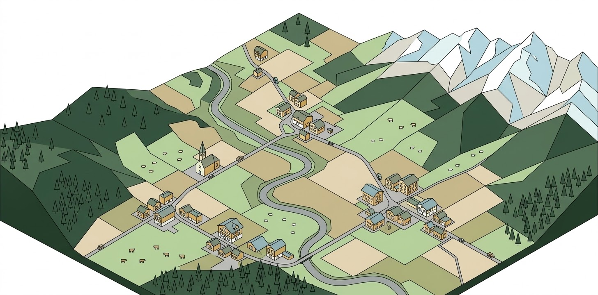
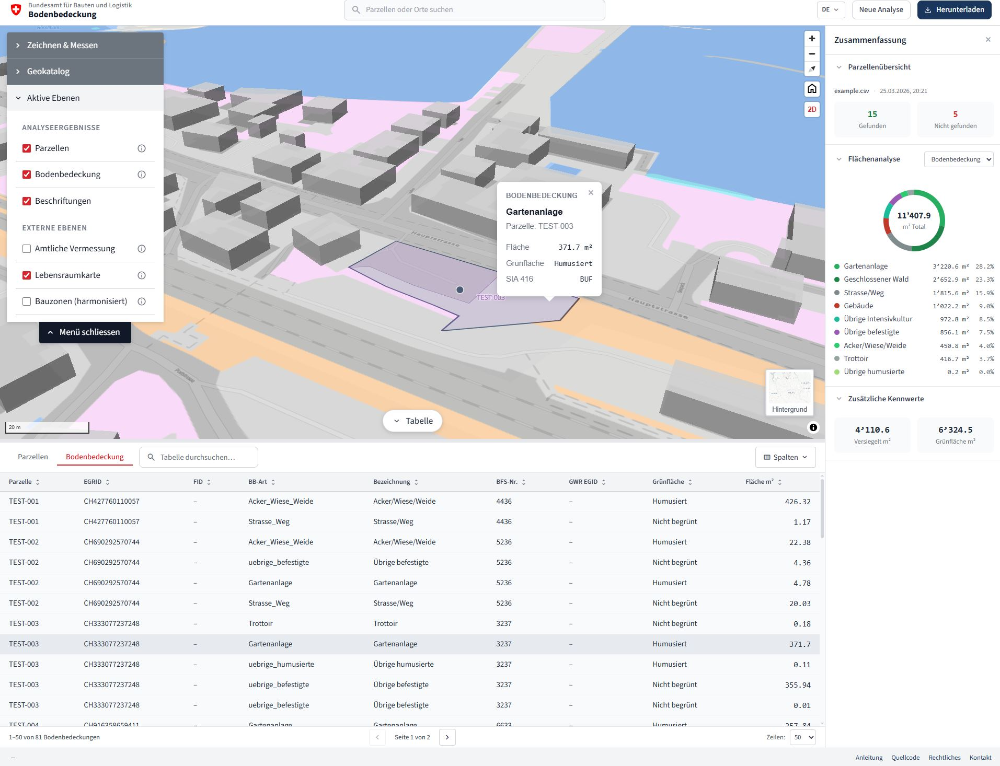
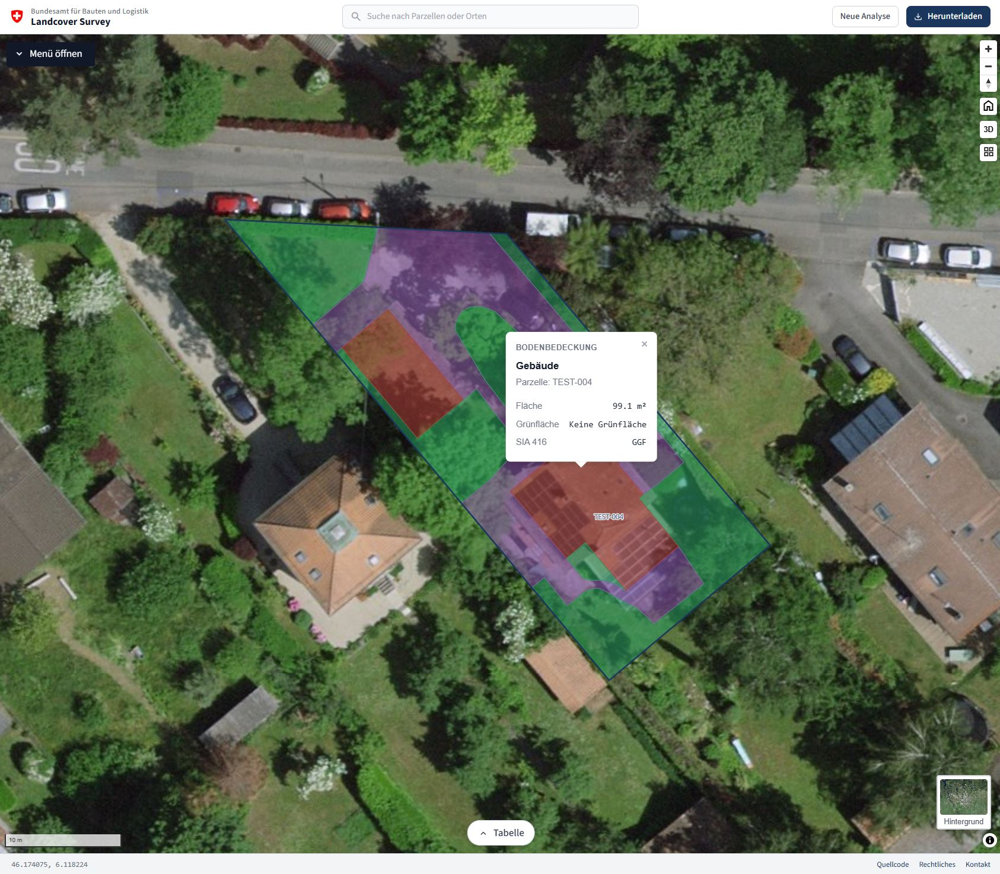

# Land Cover Survey

[](https://bbl-dres.github.io/landcover-survey/)

[](https://bbl-dres.github.io/landcover-survey/)
[](LICENSE)

Tools for calculating land-cover area per Swiss cadastral parcel from official
survey data (Amtliche Vermessung), with browser, command-line, and specialist
workflow implementations.

> [!CAUTION]
> **Alpha software for research and demonstration, not production use.** The web
> app depends on external services with known coverage and response limits; validate
> results before use. The local Python workflow can use a full GeoPackage. See the
> [user guide](docs/MANUAL.md) and [current CLI limitations](python/TODO.md).

## Demo

**Live web app:** https://bbl-dres.github.io/landcover-survey/

<table border="0" cellpadding="0" cellspacing="0" role="presentation" width="100%">
  <tr>
    <td width="50%" valign="top"></td>
    <td width="50%" valign="top"></td>
  </tr>
</table>

The repository root opens the browser implementation.

## Implementations

| Implementation | Status and purpose | Demo | Details |
|---|---|---|---|
| Web App | Alpha; interactive parcel and batch analysis | [Open app](https://bbl-dres.github.io/landcover-survey/web/) | [README](web/README.md) |
| Python CLI | Local processing with exact LV95 areas and local data | Local only | [README](python/README.md) |
| FME workspace | Original local workflow; requires a commercial FME Form licence | Local only | [README](fme/README.md) |
| Offline Dashboard | Builds a self-contained dashboard from GeoJSON | [Open app](https://bbl-dres.github.io/landcover-survey/dashboard/) | [README](dashboard/README.md) |
| Green Roof | Experimental browser-based vegetation analysis | [Open app](https://bbl-dres.github.io/landcover-survey/greenroof/) | [README](greenroof/README.md) |
| AlphaEarth | Experimental Earth Engine classification research | Local only | [README](alphaearth/README.md) |

## Run locally

Serve the repository root with any static web server:

```bash
python -m http.server 8000
```

Then open <http://localhost:8000/>. The root redirects to the web app; other hosted
tools are available at their paths shown above.

## Documentation

- [Documentation index and glossary](docs/README.md)
- [User guide and data coverage](docs/MANUAL.md)
- [Architecture, processing pipeline, and limitations](docs/ARCHITECTURE.md)
- [Classification](docs/CLASSIFICATION.md) and [data model](docs/DATAMODEL.md)
- [Current Python parity and API-limit work](python/TODO.md)

Related project: [Green Inventory](https://github.com/bbl-dres/green-inventory).

## License

[MIT](LICENSE)
