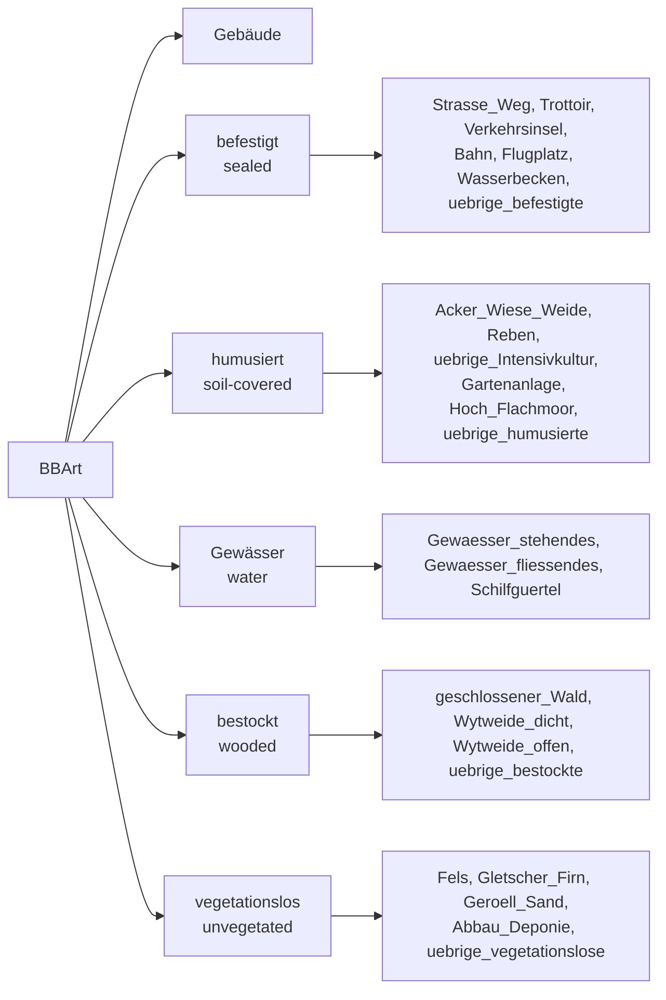

# Land Cover Classification (AV BBArt)

How each Swiss land cover type (*Bodenbedeckungsart*, **BBArt**) maps to the area
categories this tool reports. **This is the reference most users want.**

The 26 BBArt types are defined in the Swiss data model **DM.01-AV-CH** as the
`BBArt` domain — a national classification (not INSPIRE or CORINE) set out in the
technical ordinance on official surveying (TVAV, SR 211.432.21, Art. 14–19). The
data model will be replaced by **DMAV** by 2027-12-31.

For each clipped land cover piece, the tool assigns it to **five** classification
schemes. This page explains each one, with the full lookup table at the end.

| Scheme | Output | What it answers |
|--------|--------|-----------------|
| **SIA 416** | GGF / BUF / UUF | Building footprint vs. developed vs. undeveloped surroundings |
| **DIN 277** | BF / UF | Built-up vs. unbuilt |
| **Green space** | soil-covered / wooded / none | Is it green space? |
| **Sealed** | yes / no | Is the surface sealed (impervious)? |
| **AV Kategorie / Produktivität / Typ** | Kategorie A–D · produktiv 1/2 · Typ 1/2 | Green area and its two types for the near-natural (*naturnah*) reporting, as defined by BAFU |

> Where these land up in the output files (which column, which table), see
> **[DATAMODEL.md](DATAMODEL.md)**. How the geometry is clipped and areas are
> computed, see **[ARCHITECTURE.md](ARCHITECTURE.md)**.

---

## The BBArt hierarchy

The 26 leaf types group into six main categories (INTERLIS structure of
DM.01-AV-CH). This is the "AV layer map":



Formal INTERLIS definition:

```
BBArt = (
  Gebaeude,
  befestigt (
    Strasse_Weg, Trottoir, Verkehrsinsel, Bahn,
    Flugplatz, Wasserbecken, uebrige_befestigte),
  humusiert (
    Acker_Wiese_Weide,
    Intensivkultur (Reben, uebrige_Intensivkultur),
    Gartenanlage, Hoch_Flachmoor, uebrige_humusierte),
  Gewaesser (
    stehendes, fliessendes, Schilfguertel),
  bestockt (
    geschlossener_Wald,
    Wytweide (Wytweide_dicht, Wytweide_offen),
    uebrige_bestockte),
  vegetationslos (
    Fels, Gletscher_Firn, Geroell_Sand,
    Abbau_Deponie, uebrige_vegetationslose));
```

> The 26 BBArt types, their main-group / subgroup hierarchy, and DE/FR/IT names live
> in the shared [`data/landcover.json`](../data/landcover.json) reference (keyed on the
> `Art` enum value the classifier uses) — reused by the web app and the Python CLI so
> the names aren't hardcoded twice. The **classification** below (SIA 416 / DIN 277 /
> green / sealed / AV Kategorie, Produktivität, Typ) stays in code, keyed on that same `key`. This mirrors
> [`data/typoch.json`](../data/typoch.json) for the BAFU habitat layer.

---

## SIA 416 — building & surrounding areas

[SIA 416:2003](https://www.sia.ch/de/dienstleistungen/sia-norm/geodaten/). The
total parcel area **GSF** (*Grundstücksfläche*) = **GGF** + **UF**, where
**UF** (*Umgebungsfläche*) = **BUF** + **UUF**.

- **GGF** — `Gebaeude` (building footprint).
- **BUF** — all *befestigt* and *humusiert* types, incl. Wytweide (developed surroundings).
- **UUF** — everything else: water, wooded, and unvegetated types (undeveloped surroundings).

> **Note:** `Wytweide_dicht`/`Wytweide_offen` are officially *bestockt* (wooded)
> but counted as **BUF** here — actively managed pasture is *bearbeitet*.

---

## DIN 277 — built-up vs. unbuilt

[DIN 277:2021](https://www.beuth.de/de/norm/din-277/343199925). Trivial split:

- **BF** (*Bebaute Fläche* / built-up) — `Gebaeude` only.
- **UF** (*Unbebaute Fläche* / unbuilt) — everything else.

---

## Green space

Project-specific classification, following the AV *humusiert* (soil-covered) and
*bestockt* (wooded) groups with two deliberate exceptions:

- **Wytweide** (`Wytweide_dicht`, `Wytweide_offen`) — officially *bestockt*, but
  treated as **soil-covered** green space because pasture dominates over tree cover.
- **`uebrige_Intensivkultur`** — officially *humusiert*, but classified as **not**
  green space (managed horticulture: orchards, nurseries).

| Green Space Category | DE | `Art` Values |
|---------------------|-----|-------------|
| Green space (soil-covered) | Grünfläche (Humusiert) | `Acker_Wiese_Weide`, `Gartenanlage`, `Reben`, `Hoch_Flachmoor`, `uebrige_humusierte`, `Wytweide_dicht`, `Wytweide_offen` |
| Green space (wooded) | Grünfläche (Bestockt) | `geschlossener_Wald`, `uebrige_bestockte` |
| Not green space | Keine Grünfläche | All others |

> **Not the same as BAFU's «Grünflächen».** This scheme (`check_greenspace`,
> `greenspace_m2`) answers "is the surface vegetated soil or wood?" and leaves out
> water, rock and unvegetated ground. BAFU's green area for the near-natural reporting
> is wider — every type outside settlement — and is reported as **AV produktiv**
> (`av_produktiv_m2` = Typ 1 + Typ 2), see below.

---

## Sealed (imperviousness)

Sealed = `Gebaeude` + all *befestigt* types. A flat set:

`Gebaeude`, `Strasse_Weg`, `Trottoir`, `Verkehrsinsel`, `Bahn`, `Flugplatz`,
`Wasserbecken`, `uebrige_befestigte`.

Everything else is unsealed.

---

## AV Kategorie, Produktivität, Typ — naturnahe Flächen

Three **layers**, applied in order. They are written to the output as
`av_kategorie`, `av_produktiv`, `av_typ` (per land-cover piece) and as area sums per
parcel (`av_kat_a_m2` … `av_kat_d_m2`, `av_produktiv_m2`, `av_unproduktiv_m2`,
`av_typ1_m2`, `av_typ2_m2`) — see **[DATAMODEL.md](DATAMODEL.md)**.

Sources: the base categories follow the arImmo document *«Auswertung naturnahe VBS
Flächen»*; the green area and its two types follow **BAFU's definition of
9 Nov 2026** (below). The labels said «VBS» until November 2026 and say «AV» since,
because the classification is derived from the official survey; in the code the
identifiers still read `vbs` (`VBS_KATEGORIE`, `vbsTyp`).

### Layer 1 — AV Kategorie (base category A–D)

| AV Kategorie | `Art` Values |
|---------------|-------------|
| **A. Siedlungsfläche** | `Gebaeude`, `Strasse_Weg`, `Trottoir`, `Verkehrsinsel`, `Bahn`, `Flugplatz`, `Wasserbecken`, `uebrige_befestigte`, `Abbau_Deponie` |
| **B. Landwirtschaftsfläche** | `Acker_Wiese_Weide`, `Reben`, `uebrige_Intensivkultur`, `Gartenanlage`, `uebrige_humusierte`, `Wytweide_dicht`, `Wytweide_offen` |
| **C. Bestockte Fläche** | `geschlossener_Wald`, `uebrige_bestockte` |
| **D. Unproduktive Fläche** | `Hoch_Flachmoor`, `Gewaesser_stehendes`, `Gewaesser_fliessendes`, `Schilfguertel`, `Fels`, `Gletscher_Firn`, `Geroell_Sand`, `uebrige_vegetationslose` |

> **Note:** `Abbau_Deponie` sits under *vegetationslos* in the AV hierarchy but
> counts as *A. Siedlungsfläche* here.

### Layer 2 — Biological productivity (the green area)

BAFU: *«Grünflächen: nach amtlicher Vermessung alle Kategorien ausser 0–7 und 24»*
(codes as in the master table below).

| Category | Rule | Codes |
|----------|------|-------|
| **1 Biologisch produktiv** | Kategorie B + C + D | 8–23, 25 |
| **2 Biologisch unproduktiv** | Kategorie A | 0–7, 24 |

> **Changed on 2026-11-10.** `Fels`, `Gletscher_Firn` and `Geroell_Sand` (codes
> 21–23) were counted as biologically unproductive until then, following the arImmo
> document. BAFU's definition includes them in the green area, so they are productive
> now. They stay in *Kategorie D «Unproduktive Fläche»*: that name is the land-use
> category of the base layer, not a statement about this layer. Exports made before
> the change carry the old values until the parcels are processed again.

### Layer 3 — AV Typ (within the green area)

BAFU: *«Typ 1: Gartenanlagen 11. Typ 2: 8–23 (ohne 11), plus 25.»*

| AV Typ | `Art` Values | Codes |
|---------|-------------|-------|
| **Typ 1 — Grünflächen in Gebäudeumgebung** | `Gartenanlage` | 11 |
| **Typ 2 — Übrige Grünflächen** | every other biologically productive type | 8–10, 12–23, 25 |

Typ 1 + Typ 2 = biologically productive, for every parcel. Types in Kategorie A have
**no** Typ; `av_typ` is empty for them. A test on each side
(`test_classification.py`, `classification.test.mjs`) holds the tables to these code
lists.

---

## Master mapping table

Every BBArt type with all its classifications. `#` is the AV `Art` enum order.

| # | AV Main Category | AV Sub-category | AV `Art` Value | EN | DE | SIA 416 | Sealed | Green Space | AV Kat. | AV Prod. | AV Typ |
|----------|---------------|--------------|-------------|-----|-----|---------|--------|-------------|---------|-----------|---------|
| 0 | Buildings (Gebäude) | — | `Gebaeude` | Buildings | Gebäude | GGF | Yes | — | A | 2 | — |
| 1 | Sealed (Befestigt) | — | `Strasse_Weg` | Road, path | Strasse, Weg | BUF | Yes | — | A | 2 | — |
| 2 | Sealed (Befestigt) | — | `Trottoir` | Sidewalk | Trottoir | BUF | Yes | — | A | 2 | — |
| 3 | Sealed (Befestigt) | — | `Verkehrsinsel` | Traffic island | Verkehrsinsel | BUF | Yes | — | A | 2 | — |
| 4 | Sealed (Befestigt) | — | `Bahn` | Railway | Bahn | BUF | Yes | — | A | 2 | — |
| 5 | Sealed (Befestigt) | — | `Flugplatz` | Airfield | Flugplatz | BUF | Yes | — | A | 2 | — |
| 6 | Sealed (Befestigt) | — | `Wasserbecken` | Water basin | Wasserbecken | BUF | Yes | — | A | 2 | — |
| 7 | Sealed (Befestigt) | — | `uebrige_befestigte` | Other sealed surfaces | Übrige befestigte | BUF | Yes | — | A | 2 | — |
| 8 | Soil-covered (Humusiert) | — | `Acker_Wiese_Weide` | Arable land, meadow, pasture | Acker, Wiese, Weide | BUF | No | Soil-covered | B | 1 | Typ 2 |
| 9 | Soil-covered (Humusiert) | Intensive (Intensivkultur) | `Reben` | Vineyards | Reben | BUF | No | Soil-covered | B | 1 | Typ 2 |
| 10 | Soil-covered (Humusiert) | Intensive (Intensivkultur) | `uebrige_Intensivkultur` | Other intensive cultivation | Übrige Intensivkultur | BUF | No | — * | B | 1 | Typ 2 |
| 11 | Soil-covered (Humusiert) | — | `Gartenanlage` | Garden area | Gartenanlage | BUF | No | Soil-covered | B | 1 | Typ 1 |
| 12 | Soil-covered (Humusiert) | — | `Hoch_Flachmoor` | Raised/flat bog | Hoch-/Flachmoor | BUF | No | Soil-covered | D | 1 | Typ 2 |
| 13 | Soil-covered (Humusiert) | — | `uebrige_humusierte` | Other soil-covered | Übrige humusierte | BUF | No | Soil-covered | B | 1 | Typ 2 |
| 14 | Water (Gewässer) | — | `Gewaesser_stehendes` | Standing water | Stehendes Gewässer | UUF | No | — | D | 1 | Typ 2 |
| 15 | Water (Gewässer) | — | `Gewaesser_fliessendes` | Flowing water | Fliessendes Gewässer | UUF | No | — | D | 1 | Typ 2 |
| 16 | Water (Gewässer) | — | `Schilfguertel` | Reed belt | Schilfgürtel | UUF | No | — | D | 1 | Typ 2 |
| 17 | Wooded (Bestockt) | — | `geschlossener_Wald` | Closed forest | Geschlossener Wald | UUF | No | Wooded | C | 1 | Typ 2 |
| 18 | Wooded (Bestockt) | Wooded pasture (Wytweide) | `Wytweide_dicht` | Dense wooded pasture | Wytweide dicht | BUF | No | Soil-covered ** | B | 1 | Typ 2 |
| 19 | Wooded (Bestockt) | Wooded pasture (Wytweide) | `Wytweide_offen` | Open wooded pasture | Wytweide offen | BUF | No | Soil-covered ** | B | 1 | Typ 2 |
| 20 | Wooded (Bestockt) | — | `uebrige_bestockte` | Other wooded | Übrige bestockte | UUF | No | Wooded | C | 1 | Typ 2 |
| 21 | Unvegetated (Vegetationslos) | — | `Fels` | Rock | Fels | UUF | No | — | D | 1 *** | Typ 2 |
| 22 | Unvegetated (Vegetationslos) | — | `Gletscher_Firn` | Glacier, firn | Gletscher, Firn | UUF | No | — | D | 1 *** | Typ 2 |
| 23 | Unvegetated (Vegetationslos) | — | `Geroell_Sand` | Scree, sand | Geröll, Sand | UUF | No | — | D | 1 *** | Typ 2 |
| 24 | Unvegetated (Vegetationslos) | — | `Abbau_Deponie` | Extraction, landfill | Abbau, Deponie | UUF | No | — | A | 2 | — |
| 25 | Unvegetated (Vegetationslos) | — | `uebrige_vegetationslose` | Other unvegetated | Übrige vegetationslose | UUF | No | — | D | 1 | Typ 2 |

**SIA 416 legend:** **GSF** = Grundstücksfläche = GGF + UF. **GGF** =
Gebäudegrundfläche (building footprint). **UF** = Umgebungsfläche = BUF + UUF.
**BUF** = Bearbeitete Umgebungsfläche (sealed + soil-covered). **UUF** =
Unbearbeitete Umgebungsfläche (water + wooded + unvegetated). **Sealed area** =
GGF + all sealed types.

**Green Space legend:** **Soil-covered** = green space (humusiert), **Wooded** =
green space (bestockt), **—** = not green space.
\* `uebrige_Intensivkultur` is officially *humusiert* but classified as not green
space — managed horticulture (orchards, nurseries).
\*\* `Wytweide_dicht`/`Wytweide_offen` are officially *bestockt* but treated as
soil-covered — primarily open pasture with partial tree cover.

**AV legend:** **AV Kat.** = A–D base category. **AV Prod.** = 1 biologically
productive / 2 biologically unproductive. **AV Typ** = Typ 1 (green near
buildings) / Typ 2 (other green) — productive types only.
\*\*\* `Fels`, `Gletscher_Firn`, `Geroell_Sand`: productive, Typ 2, per BAFU's
definition of 9 Nov 2026; unproductive and without Typ in exports made before
2026-11-10.

---

## BAFU Lebensraumkarte (habitat overlay layer)

In the web app and the CLI's `api` source, the **BAFU Lebensraumkarte Schweiz**
(`ch.bafu.lebensraumkarte-schweiz`, TypoCH habitat types) is analysed as an **optional
overlay layer** (on by default; `--habitat` on the CLI's `gpkg` source),
independently of the AV land cover. It is its own detail layer (`lc_source = BAFU`; see
[DATAMODEL.md](DATAMODEL.md)) — *not* a substitute for AV. It's especially useful where the
AV WFS isn't freely available (no-access cantons, coverage gaps), since the habitat map
still characterises those parcels, but it runs everywhere regardless of AV coverage.

BAFU is a **modeled** habitat map (probabilistic, ~10 m), not a cadastral surface
map. It maps well to **green space and the AV classification** (naturalness), but
**cannot resolve building footprints or sealed surfaces** — so for BAFU rows only
green space + AV Kategorie / Produktivität / Typ are derived; **SIA 416 / DIN 277 /
sealed are left blank**.

Each habitat feature keeps its **full TypoCH hierarchy**: the served label (`art` —
the deepest level the layer resolved) plus `typoch_l1` / `typoch_l2` / `typoch_l3`
(each `«code» «name»`, e.g. `6 Wälder` / `6.3 Andere Laubwälder` / `6.3.1 Buchenwald`;
`typoch_l3` is empty where only level-2 exists). Parcel-level aggregation is by
**TypoCH code at level 1 and at level 2** (Lebensraumgruppe, ~34 groups): the web app
and the `api` source write `habitat_l1_<code>_m2` and `habitat_l2_<code>_m2`, the
`gpkg` source one column per level-2 group label. A feature the layer classified to
level 1 only counts under its level-1 code at both levels. Category **names** come from the shared
[`data/typoch.json`](../data/typoch.json) reference (official TypoCH 2015 list,
DE/FR/IT), reused by the web app and the Python CLI so they are not hardcoded twice.
TypoCH has 9 level-1 classes → ~41 level-2 groups → ~84 types; the map layer resolves
to level-2 at minimum, level-3 where possible.

**Green space + AV classification is refined per category**, resolved from a feature's
code **most-specific-first**: a level-2/level-3 override (`BAFU_TYPOCH_REFINE`) wins over
its level-1 class default (`BAFU_TYPOCH_L1`), which wins over a neutral fallback. The
9 level-1 class defaults:

| # | TypoCH level-1 (Hauptkategorie) | Green space | AV Kategorie | AV Prod. | AV Typ |
|---|---|---|---|---|---|
| 1 | Gewässer | — | D | 1 | Typ 2 |
| 2 | Ufer & Feuchtgebiete | soil-covered ⚠ | D | 1 | Typ 2 |
| 3 | Gletscher, Fels, Schutt, Geröll | — | D | 1 | Typ 2 |
| 4 | Grünland | soil-covered | B | 1 | Typ 2 |
| 5 | Krautsäume, Hochstauden, Gebüsche | wooded ⚠ | C | 1 | Typ 2 |
| 6 | Wälder | wooded | C | 1 | Typ 2 |
| 7 | Pionier-/Ruderalvegetation | — ⚠ | D ⚠ | 1 ⚠ | Typ 2 |
| 8 | Pflanzungen, Äcker, Kulturen | soil-covered | B | 1 | Typ 2 |
| 9 | Gebäude / Anlagen | — | A | 2 | — |

Level-2 refinements — only groups that depart from their class default are listed
(⚠ starting-point):

| Code | Level-2 group | Green space | AV Kat. | AV Prod. | AV Typ | Rationale |
|---|---|---|---|---|---|---|
| `1.3` | Quellen und Quellfluren | soil-covered | C | 1 | Typ 2 | spring flora, near-natural |
| `2.0` | Künstliche Ufer | — | A | 2 | — | constructed banks |
| `4.0` | Kunstrasen | soil-covered | A | 1 | Typ 2 | amenity / artificial lawn |
| `5.1` | Krautsäume | soil-covered | C | 1 | Typ 2 | herbaceous, not wooded |
| `5.2` | Hochstauden-/Schlagfluren | soil-covered | C | 1 | Typ 2 | tall-herb, not wooded |
| `6.0` | Forstpflanzungen | wooded | B | 1 | Typ 2 | planted, managed |
| `7.2` | Anthropogene Steinfluren | — | A | 2 | — | walls, paving |
| `8.1` | Baumschulen, Obstgärten, Rebberge | wooded | B | 1 | Typ 2 | woody crops |

Class 3 (Gletscher, Fels, Schutt, Geröll) follows the AV types it corresponds to:
productive, Typ 2, since 2026-11-10. `4.0` Kunstrasen is the one group that is
Kategorie A and still productive — a starting-point call like the others here.

> ⚠ = judgment call. **Starting-point** mapping pending validation by the
> sustainability department — the level-1 defaults live in `BAFU_TYPOCH_L1` and the
> refinements in `BAFU_TYPOCH_REFINE`, kept in lock-step between
> [processing-web/js/config.js](../processing-web/js/config.js) and [processing-cli/src/config.py](../processing-cli/src/config.py),
> so corrections are a one-line edit in both. BAFU areas are **not** directly comparable
> to authoritative AV areas; treat them as an approximation where AV is unavailable.
>
> **Codes outside the botanical typology.** The BAFU layer serves some codes the
> official InfoFlora TypoCH list doesn't carry — notably the anthropogenic `9.0.x`
> (e.g. `9.0.2 Versiegelte vegetationslose Fläche…`) and deep subdivisions like
> `4.0.0.0.3`. Their names aren't in [`data/typoch.json`](../data/typoch.json), so the
> level-2 label falls back to the **bare code** (e.g. group `9.0`). Classification still
> resolves correctly (walk-up to the level-1 class default), and web and Python agree
> byte-for-byte. To give these groups names, add BAFU's extended codes to
> `data/typoch.json` (needs an authoritative BAFU codelist).
>
> **Web ↔ Python parity: aligned.** Both the web app and the Python `--source api` path
> group at level-2, emit `typoch_l1/l2/l3`, and apply `BAFU_TYPOCH_REFINE` — verified
> identical across all 324 TypoCH labels (plus the out-of-typology codes above). The
> `--habitat` GeoPackage path also aggregates at level-2.

---

## Synthetic AV land cover (fallback where AV is missing)

Some regions return **no AV land cover** (no-access cantons, and high-alpine
"übriges Gebiet" the official survey never classified) — leaving the Bodenbedeckung
KPIs blank. To improve completeness and traceability, where AV is essentially
absent we **synthesize AV-schema land-cover features from the BAFU Lebensraumkarte**:
each clipped BAFU habitat polygon is relabelled to the AV BBArt that best matches it
and then run through the **same** `classify()` → `aggregate()` path as real AV. The
**geometry is real** (the clipped habitat polygon); only the **BBArt label is
inferred**. So the KPIs stay backed by actual feature geometry and reconcile to the
parcel area (BAFU is wall-to-wall).

**Trigger & marking.** A parcel synthesizes only when its real AV cover is below
**5 %** of the parcel area (`MIN_AV_COVER_FRAC` in
[processor.js](../processing-web/js/processor.js) and
[processor_web.py](../processing-cli/src/processor_web.py)) **and the land-cover
request answered**. After a failed request (`check_wfs` = `wfs_error`) nothing is
synthesized: the land cover is then unknown, not absent, and the parcel's area columns
stay empty. (Until 2026-11-10 a failed request triggered the fallback, so the same
parcel could get cadastral numbers on one run and modelled ones on the next.)
Synthesized parcels are marked **`lc_source = BAFU`** and **`lc_synthetic = yes`**, and
each synthetic feature keeps its source TypoCH in a `typoch` column — so synthetic
cover is never mistaken for authoritative cadastral data and every value is traceable
back to the habitat type it came from.

**Crosswalk** (`TYPOCH_BBART` in [processing-web/js/config.js](../processing-web/js/config.js) and
[processing-cli/src/classify_web.py](../processing-cli/src/classify_web.py)) — keyed by
TypoCH code, most-specific first, so a fine code overrides its level-1 default. The
refinements matter most for **class 9**, where level-1 can't tell a building from a
road (the cadastral-critical sealed / GGF split):

| TypoCH code | → BBArt | SIA 416 | Sealed | Green |
|---|---|---|---|---|
| `1` Gewässer | `Gewaesser_stehendes` | UUF | — | — |
| `2` Ufer & Feuchtgebiete | `Hoch_Flachmoor` | BUF | — | soil |
| `3` Gletscher, Fels, Schutt | `Geroell_Sand` | UUF | — | — |
| `4` Grünland | `Acker_Wiese_Weide` | BUF | — | soil |
| `5` Krautsäume, Gebüsche | `uebrige_bestockte` | UUF | — | wooded |
| `6` Wälder | `geschlossener_Wald` | UUF | — | wooded |
| `7` Pionier-/Ruderalveg. | `uebrige_vegetationslose` | UUF | — | — |
| `8` Pflanzungen, Äcker, Kulturen | `Acker_Wiese_Weide` | BUF | — | soil |
| `9` Gebäude/Anlagen *(default)* | `uebrige_befestigte` ⚠ | BUF | yes | — |
| `9.2` Bauten | `Gebaeude` | **GGF** | yes | — |
| `9.3.2` Asphalt-/Betonstrasse | `Strasse_Weg` | BUF | yes | — |
| `9.0.2` Versiegelte vegetationslose Fläche | `uebrige_befestigte` | BUF | yes | — |
| `9.3.3` Naturstrasse/Weg *(unbefestigt)* | `uebrige_vegetationslose` ⚠ | UUF | — | — |

> ⚠ = judgment call. **Starting-point** mapping pending validation against real AV
> on dual-coverage parcels (where both AV and BAFU exist, the synthetic classification
> can be compared to ground truth per BBArt / sealed / green). The TypoCH typology is
> [Delarze et al. (TypoCH)](https://www.infoflora.ch/en/habitats/typoch-(delarze-et-al.).html);
> a TypoCH code without an entry gives no synthetic feature (the piece is skipped).
> The synthetic feature gets its AV Kategorie, Produktivität and Typ from the BBArt it
> was relabelled to, like any AV feature. Building footprints from a ~10 m modeled map are the weakest field — treat
> synthetic `GGF` with the most caution.

---

## Legal basis & references

- [TVAV (SR 211.432.21)](https://www.fedlex.admin.ch/eli/cc/2023/530/de) —
  Technical Ordinance on the Official Cadastral Survey (Art. 14–19: land cover
  categories / BBArt domain).
- [DM.01-AV-CH](https://www.cadastre-manual.admin.ch/de/datenmodell-der-amtlichen-vermessung-dm01-av-ch)
  — current INTERLIS data model (replaced by **DMAV** by 2027-12-31).
- [SIA 416:2003](https://www.sia.ch/de/dienstleistungen/sia-norm/geodaten/) —
  building surfaces and volumes (GGF / BUF / UUF).
- [DIN 277:2021](https://www.beuth.de/de/norm/din-277/343199925) — floor areas
  and building volumes (BF / UF).
- *Auswertung naturnahe VBS Flächen* (arImmo internal) — the base categories A–D.
- BAFU, *Übersicht Typ 1 und Typ 2 nach amtlicher Vermessung* (email of 9 Nov 2026,
  «Methode Flächenberechnung naturnah») — the green area (all types except codes 0–7
  and 24), Typ 1 (code 11) and Typ 2 (8–23 without 11, plus 25).
